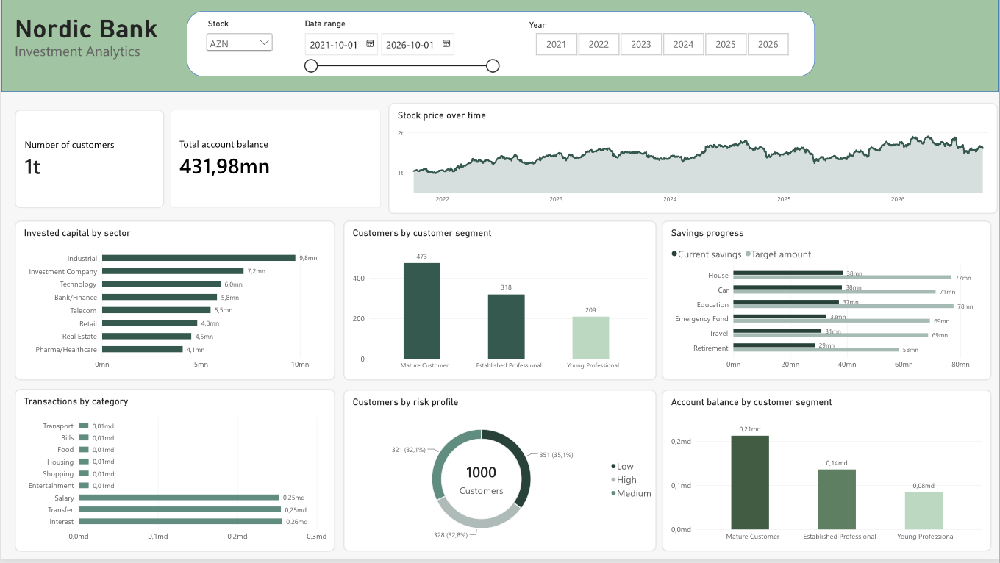
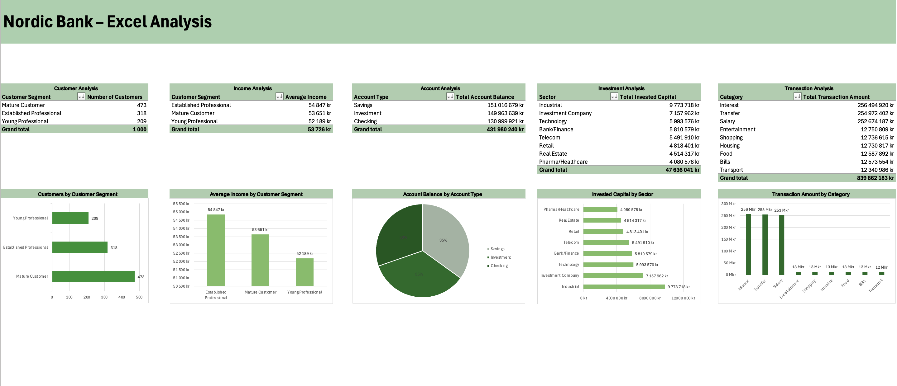

# Nordic Bank – Data Analytics & Business Intelligence

## About the Project

Nordic Bank is a personal learning project focused on data analytics and business intelligence in a fictional banking environment.

The project explores how data can be generated, stored, analyzed, and visualized to support business decisions. It combines Python, PostgreSQL, SQL, Excel, and Power BI in a data analytics workflow.

The project is ongoing and is being developed to strengthen my practical skills in data analysis, database management, and business intelligence.

## Project Objectives

- Generate fictional banking data using Python.
- Design and manage a relational database in PostgreSQL.
- Write SQL queries to analyze customers, accounts, transactions, investments, and savings goals.
- Use Excel to explore and analyze data.
- Build interactive Power BI reports to visualize key metrics and trends.
- Identify business insights and potential actions based on the analysis.

## Technologies

- **Python** – Data generation and market data collection.
- **PostgreSQL** – Relational database and data storage.
- **SQL** – Data querying and business analysis.
- **pandas** – Data handling and processing.
- **yfinance** – Retrieving historical market data.
- **Excel** – Data exploration and analysis.
- **Power BI** – Interactive reports and business intelligence.

## Database

The database contains six main tables:

| Table | Description |
|---|---|
| `Customer` | Customer information, income, risk profile, and customer segment. |
| `Account` | Customer accounts and account balances. |
| `Transactions` | Transaction dates, amounts, categories, and types. |
| `Investment` | Customer investments, including asset types, sectors, quantities, and purchase prices. |
| `SavingsGoal` | Customer savings goals, target amounts, and current savings. |
| `MarketData` | Historical market prices and trading volumes for selected assets. |

The tables are connected through primary keys and foreign keys where appropriate.

## Project Workflow

The project follows a data analytics workflow:

1. **Data Generation** – Python scripts generate fictional customers, accounts, transactions, investments, and savings goals.
2. **Market Data Collection** – Python retrieves historical market data using `yfinance`.
3. **Database Management** – PostgreSQL stores the data in a relational database.
4. **SQL Analysis** – SQL queries explore customer segments, account balances, transactions, investments, and savings progress.
5. **Data Analysis in Excel** – Excel is used to explore data and perform additional analysis.
6. **Business Intelligence in Power BI** – Interactive reports visualize key metrics, patterns, and trends.
7. **Business Insights** – The results can be used to identify areas for further investigation and potential business improvements.

## Power BI Dashboard

The Power BI report provides an overview of key metrics and patterns within the fictional banking data.

It includes visualizations related to customer segments, account balances, investments, market data, savings goals, and transactions.



## Excel Analysis

Excel is used for additional data exploration and analysis, complementing the SQL queries and Power BI report.



## Project Structure

```text
Nordic-Bank/
├── database/
│   ├── schema.sql
│   └── analysis.sql
├── src/
│   ├── fetch_market_data.py
│   ├── generate_accounts.py
│   ├── generate_customers.py
│   ├── generate_investments.py
│   ├── generate_savings_goals.py
│   └── generate_transactions.py
├── excel/
│   └── Excel analysis files
├── powerbi/
│   └── Power BI report files
├── .gitignore
├── README.md
└── requirements.txt
```

## Current Development Focus

The project is being developed further with a focus on:

- Improving SQL analysis and data quality.
- Exploring customer and transaction patterns.
- Analyzing investment values using market data.
- Developing clear and useful Power BI visualizations.
- Turning analytical findings into business insights and potential recommendations.

## Data and Limitations

This project uses fictional banking and customer data generated for learning purposes. Historical market data is retrieved from an external source.

The project is an educational exercise and does not represent a real bank, production-ready banking system, or financial advice.

## Purpose

The purpose of this project is to gain practical experience in the complete data analytics process, from data generation and database design to analysis, visualization, and business decision support.